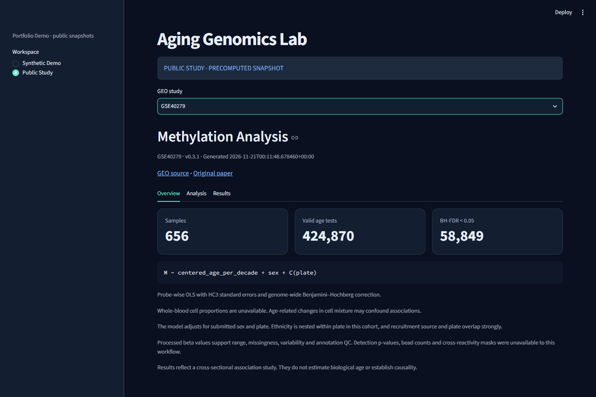
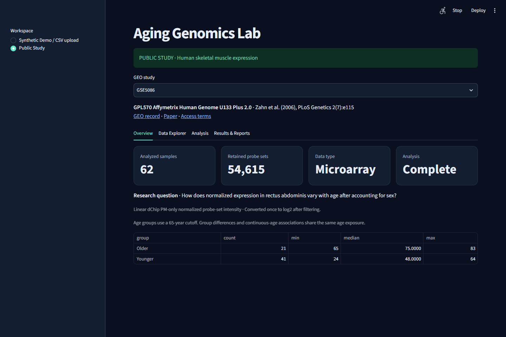
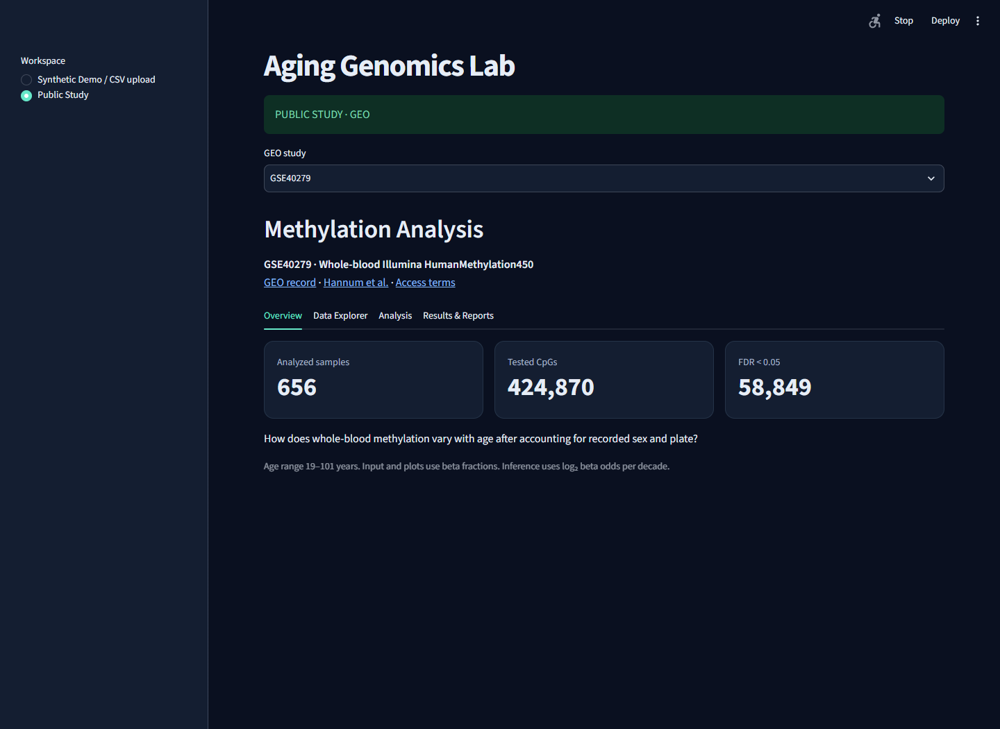

# 🧬 Aging Genomics Lab

**Reproducible age-association analysis · v0.3.1**

An open-source research software workbench for analyzing age associations in public human gene expression and DNA methylation cohorts. The project combines a Streamlit interface, reproducible Python CLI, verified GEO ingestion, statistical checks, and provenance exports.

The **Public Study** workspace includes two workflows. **Expression Analysis** examines age and human rectus abdominis expression in GSE5086. **Methylation Analysis** tests age associations in whole-blood CpG methylation in GSE40279. The **Synthetic Demo** uses generated samples and runs offline.



[Release notes](RELEASE_NOTES_v0.3.1.md) · [Scientific audit](docs/RELEASE_AUDIT.md) · [Citation](CITATION.cff)

## Quick start — Windows / VS Code (最简单)

1. Unzip the project; open the **whole `human-genomics-aging-starter` folder** in VS Code.
2. Install Python 3.10+ (3.11/3.12 recommended) and make sure `py` or `python` runs in CMD.
3. Double-click **`scripts/start_windows.bat`** (or run it from the VS Code terminal).
4. Open **http://localhost:8501**. The dashboard runs without API keys or external datasets.
5. Stop with `Ctrl+C` in the terminal.

The *first* run needs internet to download Python packages. Later local runs use the virtual environment. No external service is needed to analyze the bundled demonstration.

### Manual setup / Mac / Linux

```bash
python -m venv .venv
# Windows PowerShell:
.venv\Scripts\Activate.ps1
# macOS/Linux: source .venv/bin/activate
python -m pip install -e ".[dev]"
python -m streamlit run app.py
```

On macOS/Linux, you can instead run `bash scripts/start_mac_linux.sh`.

### Portfolio Demo

From the repository root after installation, start the read-only public-study demo:

```powershell
$env:AGING_GENOMICS_MODE = "portfolio"
python -m streamlit run app.py --server.address=127.0.0.1
```

The synthetic workflow calculates from the bundled simulated data. Public Study shows versioned study summaries, p-value distributions and example feature estimates from the verified offline runs. Public-study downloads and CSV uploads are unavailable in this mode. Set `AGING_GENOMICS_MODE=research` or launch from a fresh shell for the full local workbench. Health endpoint: `/_stcore/health`. [Deployment and resource limits](docs/DEPLOYMENT.md)

## What works today

| Feature | Status | Scope |
|---|---|---|
| Local research dashboard | ✅ | Overview, PCA, cohort ages, volcano, heatmap, age scatter, preview |
| Validated CSV ingestion | ✅ | gene_id × sample_id matrix and matching metadata |
| Differential expression | ✅ exploratory | Welch t-test + Benjamini–Hochberg; log2 continuous values **only** |
| Age association | ✅ exploratory | Spearman correlation + BH; **not adjusted** for covariates |
| Reproducibility | ✅ | Input SHA-256, stats methods, software version and CSV/ZIP exports |
| Automated tests | ✅ | Data validation, simulation, statistics, CLI reporting |
| Verified GEO study | Available | GSE5086 acquisition, probe annotation, cohort and QC logs |
| Public microarray statistics | Available | Sex-adjusted HC3 regression, BH-FDR, PCA and HTML/CSV reports |
| Published study comparison | Available | Zahn Table S2 identifier, direction and methods audit |
| Public methylation EWAS | Available | GSE40279 beta QC, M-value regression, sex and plate adjustments, CpG annotation and offline reports |
| Raw RNA-seq counts | Planned | Separate DESeq2/edgeR design |
| GWAS / TWAS / gene regulation | ◇ future | Separate domain-specific modules |
| HPC / Slurm / Nextflow | ◇ future | Reproducible research workloads |

For **real CSV uploads**, verify your upstream normalization/log2 preprocessing and tick the explicit confirmation checkbox in the sidebar before analysis.

## CLI (without opening browser)

After installation:

```bash
python -m aginggenomics.cli analyze \
  --expression data/demo/expression.csv \
  --metadata data/demo/metadata.csv \
  --out output/demo-analysis \
  --simulated \
  --source SYNTHETIC_AGING_DEMO_V1

python -m pytest
```

Windows CMD: put the `analyze` command on one line or replace `\` with `^`. For **non-synthetic** data, replace `--simulated` with `--ack-normalized-log2` after verifying preprocessing.

CLI writes `differential_expression.csv`, `age_association.csv`, `sample_pca.csv`, `report.md`, `provenance.json` under the selected output directory. The dashboard exports the corresponding ZIP in memory; it doesn't write into `output/` automatically.

## Input contract

`expression.csv`: **rows are genes**, columns after `gene_id` are samples. Values already represent **pre-normalized log2 expression**, e.g. normalized microarray signals. Raw RNA-seq counts require a different statistical model.

```csv
gene_id,S001,S002,S003,S004,S005,S006
GENE_A,8.1,8.2,7.9,9.1,9.2,8.9
GENE_B,5.2,5.1,5.0,4.8,4.9,5.1
```

`metadata.csv`:

```csv
sample_id,group,age,batch,sex
S001,Younger,25,B1,F
S002,Younger,29,B1,M
S003,Younger,32,B2,F
S004,Older,67,B1,M
S005,Older,72,B2,F
S006,Older,78,B2,M
```

`group` must have exactly two categories with **at least three samples each** and at least three distinct ages; `sample_id` must match all expression sample columns. `batch` and `sex` may be present but **are not adjusted for yet**. See [docs/DATA_CONTRACT.md](docs/DATA_CONTRACT.md).

## Reproduce the public study

```powershell
.venv\Scripts\python.exe -m aginggenomics.cli public --study GSE5086 --out output/GSE5086
.venv\Scripts\python.exe -m aginggenomics.cli public --offline --out output/GSE5086
```

The first command downloads and verifies the pinned GEO matrix and platform annotation when needed. The offline command verifies cached artifacts without network access. Use `--cache` to point to a separate local cache. In Streamlit select **Public Study → GSE5086 → Data Explorer**, then load the verified cache or download from GEO. Open **Analysis** for Plotly charts and **Results & Reports** to filter probes and export the run.

The public run writes `report.md`, `report.html`, `provenance.json`, five standalone interactive HTML charts and CSV tables for model estimates, PCA, sample selection, sample QC and probe filters. The ZIP uses the same export code as the CLI. GEO files and generated outputs live in ignored local directories.

### Observed Windows run · GSE5086

| Measure | Observed |
|---|---:|
| GEO samples / GPL570 probe sets | 81 / 54,675 |
| Analyzed rectus abdominis samples | 62 |
| Younger (<65) / Older (≥65) | 41 / 21 |
| Probes excluded for zero intensity in the analyzed cohort | 60 |
| Probes tested in each model | 54,615 |
| Group hits at FDR < 0.05 and absolute log2 effect ≥ 0.5 | 0 |
| Continuous age hits at FDR < 0.05 | 0 |

This is an exploratory secondary analysis. The project uses a single anatomical site, probe-level HC3 models and its own cutoff. The paper used gene-level aggregation and a different analysis design. See [study cards and access terms](docs/PUBLIC_STUDIES.md) and [methods and failure modes](docs/STATISTICAL_SCOPE.md).



[Analysis screenshot](docs/screenshots/public-analysis.png) · [Results and Reports screenshot](docs/screenshots/public-results.png)

## Reproduce the published comparison and EWAS

```powershell
.venv\Scripts\python.exe -m aginggenomics.cli compare-published --out output/GSE5086-comparison
.venv\Scripts\python.exe -m aginggenomics.cli ewas --out output/GSE40279
```

Add `--offline` after caching the sources. Fetching only the EWAS sources is also available through `scripts/fetch_public_dataset.py --study GSE40279` using the project Python. The first EWAS download needs roughly 1.3 GB for the verified cache plus room for reports. The matrix supports resumable HTTP transfers. A bounded 65 MiB range captures the complete platform annotation table. In the dashboard, select **Public Study → GSE40279 → Data Explorer** to open a local report or run the analysis.

### Regenerate the portfolio snapshot

```sh
python -m aginggenomics.cli public --offline --out output/release/GSE5086
python -m aginggenomics.cli compare-published --offline --out output/release/GSE5086-comparison
python -m aginggenomics.cli ewas --offline --out output/release/GSE40279
python scripts/build_portfolio_snapshot.py
```

Each snapshot includes the analysis version and UTC generation time from its local report. The builder emits counts, p-value histograms, eight feature-level example rows per study and the source-result checksum.

The Zahn comparison links **113 of 250** published rows to retained probes. Across **219** matched pairs, **196** agree in direction. The original paper reported 250 genes under its nominal threshold and estimated false positives by permutation. The primary P1 result was zero probes at BH-FDR <0.05. The comparison report details cohort, aggregation, mapping and inference differences.

The GSE40279 run analyzed **656 samples**, ages **19–101**, and tested **424,870 of 473,034** submitted probe rows. **58,849 CpGs** passed BH-FDR <0.05. This is a cross-sectional whole-blood analysis using M-values and adjustment for sex and plate. Blood-cell composition remains an unmeasured confounder. [Study cards](docs/PUBLIC_STUDIES.md) · [Methods and limitations](docs/STATISTICAL_SCOPE.md)



[EWAS analysis screenshot](docs/screenshots/ewas-analysis.png)

## Why this project

This repo targets transferable scientific-software skills relevant to:

- **USC Leonard Davis School of Gerontology — Bioinformatics Core:** aging, gene expression, statistical genomics and reproducible data pipelines.
- **Stanford Kundaje Lab:** genetic regulation, large-scale data processing and interpretable computational models.
- **Salk Integrated Genomics Core:** robust research pipelines, Linux workflows, reproducibility and HPC expansion.

It shows **newly built skills and capabilities**, not past years of bioinformatics employment. See [docs/RESEARCH_ALIGNMENT.md](docs/RESEARCH_ALIGNMENT.md).

## Architecture

Python 3.10+, pandas and NumPy handle GEO ingestion, metadata alignment and array preprocessing. SciPy supplies statistical distributions, Plotly provides interactive figures, and Streamlit presents the workbench. The CLI and dashboard share the public acquisition, statistical and export code.

`GEO → SHA-256 verified cache → sample and probe QC → sex-adjusted models / PCA → CSV, HTML, Markdown and provenance`

## File structure

```text
app.py                       Streamlit UI
src/aginggenomics/          Validated analysis Python package
  data.py                    Input contract and checks
  analysis.py                PCA, Welch tests, BH-FDR, Spearman, QC
  simulation.py              Deterministic synthetic data generator
  reporting.py               CLI reports + SHA-256 provenance
  ingest/geo.py              Bounded GEO download and checksum validation
  public_studies.py          GSE5086 metadata, scale validation and GPL570 mapping
  public_analysis.py         Sex-adjusted models, interactive plots and exports
  public_dashboard.py        Public study workspace
  published_comparison.py    Published Zahn Table S2 audit
  methylation_study.py      Bounded beta blocks and GSE40279 metadata
  methylation_analysis.py   M-value EWAS, probe and sample QC, PCA
  methylation_reporting.py  EWAS provenance, tables and interactive charts
  methylation_dashboard.py  Independent Streamlit methylation workflow
  cli.py                     Command-line tool
scripts/                     Windows / macOS / Linux launchers
data/demo/                   ONLY synthetic dataset, with manifest & truth
  expression.csv
  metadata.csv
  manifest.json
  simulation_truth.csv
tests/                       Regression tests
.github/workflows/ci.yml     GitHub Actions test suite
docs/                        Statistics, research context, Codex plan
AGENTS.md                    Guardrails for coding agents
CODEX_NEXT_STEPS.md          Copy/paste task for Codex
```

## Research integrity & privacy

The app is a local analysis aid, not a medical tool. It does not access patient databases or obtain human participant files. Do not commit restricted genomic data, private sample identifiers or secrets to a public repository. Download GEO data only according to the dataset's access, consent and usage terms. Validate batch effects, covariates, replicates, model assumptions and lineage before publishing any result.

The [MIT license](LICENSE) covers project code and original documentation. Generated synthetic fixtures are CC0. The repository contains aggregate study summaries and selected feature estimates computed by this project. GEO matrices, participant records and publisher supplements remain excluded. [Third-party source terms](docs/PUBLIC_STUDIES.md) · [Contribution guide](CONTRIBUTING.md)

## Validation status

Run `python -m pytest` (or `scripts\test_windows.bat`). GitHub Actions is configured for offline fixtures and a synthetic CLI smoke run on Python 3.10 and 3.12. See [local acceptance and CI status](docs/VERIFICATION.md).

## Roadmap

P3 explores GWAS/TWAS summary statistics. P4 covers regulatory modeling, and P5 covers Nextflow/Snakemake and HPC execution. Reference-based blood-composition adjustment remains a future EWAS sensitivity analysis. See [the development roadmap](CODEX_NEXT_STEPS.md).
